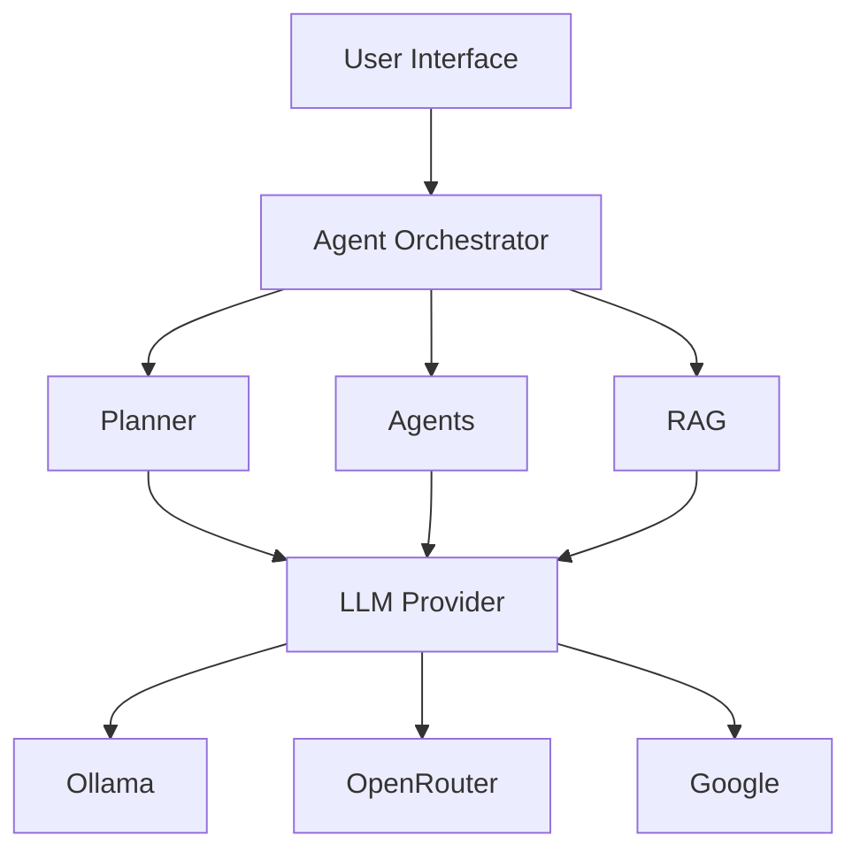
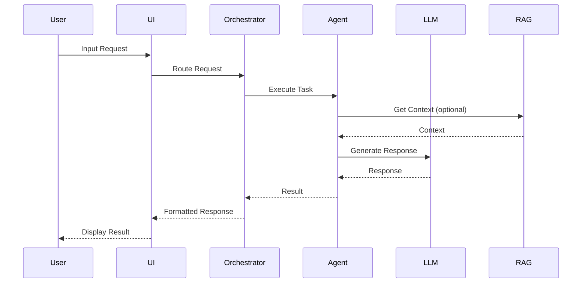
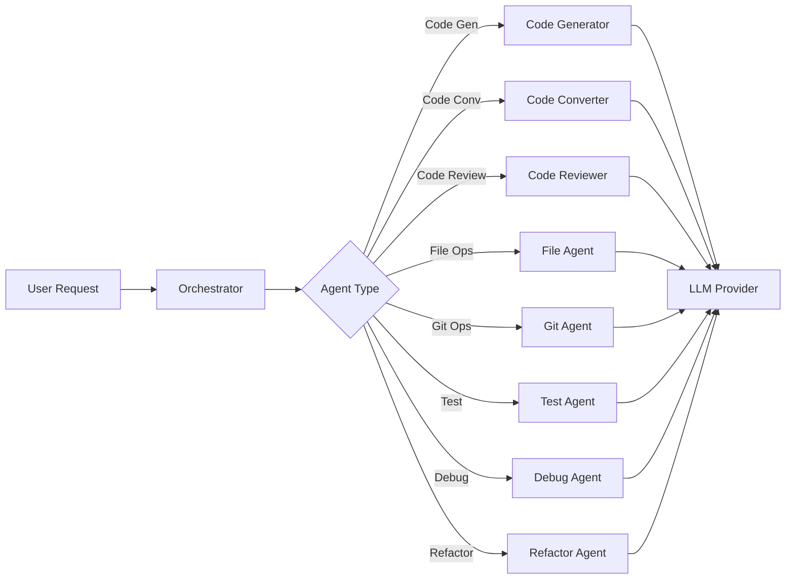

# JeshlaAIAgent - Architecture Diagrams

This document contains visual diagrams of the project structure and working flow in an easy-to-understand GUI format.

---

## Table of Contents
1. [High-Level Architecture](#high-level-architecture)
2. [Project Structure Tree](#project-structure-tree)
3. [Data Flow Diagram](#data-flow-diagram)
4. [Component Interaction Diagram](#component-interaction-diagram)
5. [User Journey Flow](#user-journey-flow)
6. [LLM Provider Architecture](#llm-provider-architecture)
7. [Agent Orchestration Flow](#agent-orchestration-flow)
8. [RAG System Architecture](#rag-system-architecture)

---

## High-Level Architecture

```
┌─────────────────────────────────────────────────────────────────┐
│                     JeshlaAIAgent System                         │
│                                                                  │
│  ┌────────────────────────────────────────────────────────────┐ │
│  │                   USER INTERFACE LAYER                     │ │
│  │                                                              │ │
│  │   ┌──────────┐    ┌──────────┐    ┌──────────┐           │ │
│  │   │   Chat   │    │   Plan   │    │  Agents  │           │ │
│  │   │ Section  │    │ Section  │    │ Section  │           │ │
│  │   └────┬─────┘    └────┬─────┘    └────┬─────┘           │ │
│  └────────┼─────────────┼─────────────┼──────────────────────┘ │
│           │             │             │                          │
└───────────┼─────────────┼─────────────┼──────────────────────────┘
            │             │             │
            └─────────────┴─────────────┘
                          │
                          ▼
┌─────────────────────────────────────────────────────────────────┐
│                   APPLICATION LOGIC LAYER                         │
│                                                                  │
│  ┌────────────────────────────────────────────────────────────┐ │
│  │              Agent Orchestrator (Controller)              │ │
│  │  ┌────────────────────────────────────────────────────┐  │ │
│  │  │  • Route tasks to appropriate agents                │  │ │
│  │  │  • Manage agent coordination                        │  │ │
│  │  │  • Handle agent handoff                             │  │ │
│  │  └────────────────────────────────────────────────────┘  │ │
│  └────────────────────────┬───────────────────────────────────┘ │
│                           │                                     │
│      ┌────────────────────┼────────────────────┐              │
│      ▼                    ▼                    ▼              │
│  ┌─────────┐        ┌─────────┐        ┌─────────┐          │
│  │ Planner │        │  Agents │        │   RAG   │          │
│  │   AI    │        │  System  │        │  Engine  │          │
│  └────┬────┘        └────┬────┘        └────┬────┘          │
└───────┼─────────────────┼─────────────────┼──────────────────┘
        │                 │                 │
        ▼                 ▼                 ▼
┌─────────────────────────────────────────────────────────────────┐
│                      CORE LAYER                                 │
│                                                                  │
│  ┌──────────────┐  ┌──────────────┐  ┌──────────────┐        │
│  │ LLM Provider │  │   Tools      │  │   Config     │        │
│  │              │  │              │  │              │        │
│  │ • Ollama     │  │ • File Ops   │  │ • Settings    │        │
│  │ • OpenRouter │  │ • Git Ops    │  │ • Prompts     │        │
│  │ • Google     │  │ • Test Run   │  │              │        │
│  │              │  │ • Code Parse │  │              │        │
│  └──────────────┘  │ • Debugger   │  └──────────────┘        │
│                    │ • Search     │                          │
│                    └──────────────┘                          │
└─────────────────────────────────────────────────────────────────┘
```

---

## Project Structure Tree

```
JeshlaAIAgent/
│
├── 📄 .env                          # ⚙️ Environment Configuration
├── 📄 requirements.txt              # 📦 Python Dependencies
├── 📄 README.md                     # 📖 Project Documentation
├── 📄 SETUP_GUIDE.md                # 📘 Setup Instructions
├── 📄 PROJECT_PLAN.md               # 📋 Implementation Plan
├── 📄 ARCHITECTURE_DIAGRAMS.md      # 🎨 This File
├── 📄 test_basic.py                 # 🧪 Basic Tests
│
├── 📁 config/                       # ⚙️ Configuration
│   ├── 📄 __init__.py
│   ├── 📄 settings.py              # 🔧 Settings Management
│   └── 📄 prompts.py               # 💬 System Prompts
│
├── 📁 core/                         # 🎯 Core Business Logic
│   ├── 📄 __init__.py
│   │
│   ├── 📁 llm/                     # 🤖 LLM Providers
│   │   ├── 📄 __init__.py
│   │   ├── 📄 base.py              # 📐 Base Interface
│   │   ├── 📄 ollama_provider.py   # 🦙 Ollama (Local)
│   │   ├── 📄 openrouter_provider.py  # 🌐 OpenRouter (Cloud)
│   │   └── 📄 google_provider.py   # 🔍 Google AI Studio
│   │
│   ├── 📁 planner/                 # 📋 Planning System
│   │   ├── 📄 __init__.py
│   │   ├── 📄 task_planner.py      # 🎯 Task Decomposition
│   │   ├── 📄 plan_executor.py     # ⚡ Plan Execution
│   │   └── 📄 plan_tracker.py      # 📊 Plan Tracking
│   │
│   ├── 📁 agents/                  # 🤖 Specialized Agents
│   │   ├── 📄 __init__.py
│   │   ├── 📄 agent_orchestrator.py  # 🎮 Agent Coordinator
│   │   ├── 📄 code_generator.py    # 💻 Code Generator
│   │   ├── 📄 code_converter.py    # 🔄 Code Converter
│   │   ├── 📄 code_reviewer.py     # 👁️ Code Reviewer
│   │   ├── 📄 file_agent.py        # 📁 File Agent
│   │   ├── 📄 git_agent.py         # 🔀 Git Agent
│   │   ├── 📄 test_agent.py        # 🧪 Test Agent
│   │   ├── 📄 debug_agent.py       # 🐛 Debug Agent
│   │   └── 📄 refactor_agent.py    # ♻️ Refactor Agent
│   │
│   └── 📁 tools/                   # 🔧 Core Tools
│       ├── 📄 __init__.py
│       ├── 📄 file_ops.py          # 📁 File Operations
│       ├── 📄 git_ops.py           # 🔀 Git Operations
│       ├── 📄 test_runner.py       # 🧪 Test Runner
│       ├── 📄 code_parser.py       # 📄 Code Parser
│       ├── 📄 debugger.py          # 🐛 Debugger
│       └── 📄 search.py            # 🔍 Search
│
├── 📁 rag/                         # 🧠 RAG System
│   ├── 📄 __init__.py
│   ├── 📄 indexer.py               # 📚 Codebase Indexer
│   ├── 📄 vector_store.py          # 💾 Vector Store (ChromaDB)
│   └── 📄 retriever.py             # 🔎 Context Retriever
│
├── 📁 ui/                          # 🖥️ User Interface
│   ├── 📄 __init__.py
│   ├── 📄 app.py                   # 🚀 Main Application
│   │
│   ├── 📁 components/              # 🧩 UI Components
│   │   ├── 📄 __init__.py
│   │   ├── 📄 chat_interface.py    # 💬 Chat UI
│   │   ├── 📄 plan_viewer.py       # 📋 Plan Viewer
│   │   ├── 📄 agent_status.py      # 🤖 Agent Status
│   │   ├── 📄 code_editor.py       # 💻 Code Editor
│   │   ├── 📄 file_browser.py      # 📁 File Browser
│   │   ├── 📄 settings_panel.py    # ⚙️ Settings Panel
│   │   └── 📄 terminal.py         # 💻 Terminal
│   │
│   └── 📁 styles/
│       └── 📄 custom.css           # 🎨 Custom Styles
│
├── 📁 utils/                       # 🔧 Utilities
│   ├── 📄 __init__.py
│   ├── 📄 logger.py                # 📝 Logger
│   └── 📄 helpers.py               # 🛠️ Helper Functions
│
└── 📁 tests/                       # 🧪 Tests
    ├── 📄 __init__.py
    ├── 📄 test_llm.py
    ├── 📄 test_agents.py
    └── 📄 test_rag.py
```

---

## Data Flow Diagram

```
┌─────────────┐
│   USER      │
│  (Browser)  │
└──────┬──────┘
       │
       │ 1. User Input
       ▼
┌─────────────────────────────────────────────────────────────┐
│                    STREAMLIT UI                              │
│                                                              │
│  ┌──────────┐  ┌──────────┐  ┌──────────┐                 │
│  │  Chat    │  │  Plan    │  │  Agents  │                 │
│  └────┬─────┘  └────┬─────┘  └────┬─────┘                 │
└───────┼─────────────┼─────────────┼────────────────────────┘
        │             │             │
        │ 2. Route Request
        ▼
┌─────────────────────────────────────────────────────────────┐
│              AGENT ORCHESTRATOR                               │
│                                                              │
│  ┌────────────────────────────────────────────────────┐    │
│  │  • Analyze Request Type                            │    │
│  │  • Select Appropriate Agent                         │    │
│  │  • Prepare Context                                  │    │
│  └────────────────────────────────────────────────────┘    │
└──────────────────────────┬──────────────────────────────────┘
                           │
        ┌──────────────────┼──────────────────┐
        │                  │                  │
        ▼                  ▼                  ▼
┌──────────────┐   ┌──────────────┐   ┌──────────────┐
│Code Generator│   │Code Converter│   │Code Reviewer │
└──────┬───────┘   └──────┬───────┘   └──────┬───────┘
       │                  │                  │
       │ 3. Use Tools     │                  │
       ▼                  ▼                  ▼
┌─────────────────────────────────────────────────────────────┐
│                    TOOL LAYER                                 │
│                                                              │
│  ┌──────────────┐  ┌──────────────┐  ┌──────────────┐     │
│  │  File Ops    │  │  Git Ops     │  │  Test Runner │     │
│  └──────────────┘  └──────────────┘  └──────────────┘     │
│                                                              │
│  ┌──────────────┐  ┌──────────────┐  ┌──────────────┐     │
│  │ Code Parser  │  │  Debugger    │  │   Search     │     │
│  └──────────────┘  └──────────────┘  └──────────────┘     │
└──────────────────────────┬──────────────────────────────────┘
                           │
                           │ 4. LLM Call
                           ▼
┌─────────────────────────────────────────────────────────────┐
│                 LLM PROVIDER LAYER                           │
│                                                              │
│  ┌──────────────┐  ┌──────────────┐  ┌──────────────┐     │
│  │   Ollama     │  │  OpenRouter  │  │   Google     │     │
│  │   (Local)    │  │   (Cloud)    │  │   (Cloud)    │     │
│  └──────────────┘  └──────────────┘  └──────────────┘     │
└──────────────────────────┬──────────────────────────────────┘
                           │
                           │ 5. Optional RAG Context
                           ▼
┌─────────────────────────────────────────────────────────────┐
│                     RAG LAYER                                 │
│                                                              │
│  ┌──────────────┐  ┌──────────────┐  ┌──────────────┐     │
│  │   Indexer    │──▶│ Vector Store │──▶│  Retriever   │     │
│  └──────────────┘  └──────────────┘  └──────────────┘     │
│                                                              │
│  Code Chunks ──▶ Embeddings ──▶ ChromaDB ──▶ Context      │
└──────────────────────────┬──────────────────────────────────┘
                           │
                           │ 6. Response
                           ▼
┌─────────────────────────────────────────────────────────────┐
│                 RESPONSE FORMATTING                           │
│                                                              │
│  • Add code blocks                                          │
│  • Format with syntax highlighting                          │
│  • Include context                                          │
│  • Add suggestions                                           │
└──────────────────────────┬──────────────────────────────────┘
                           │
                           │ 7. Display
                           ▼
┌─────────────────────────────────────────────────────────────┐
│                  STREAMLIT UI (Display)                       │
│                                                              │
│  ┌────────────────────────────────────────────────────┐    │
│  │  • Chat message with code                          │    │
│  │  • Plan status update                              │    │
│  │  • Agent execution result                           │    │
│  └────────────────────────────────────────────────────┘    │
└──────────────────────────┬──────────────────────────────────┘
                           │
                           ▼
┌─────────────┐
│   USER      │
│  (Browser)  │
└─────────────┘
```

---

## Component Interaction Diagram

```
                    ┌─────────────────┐
                    │   Streamlit UI  │
                    │   (app.py)      │
                    └────────┬────────┘
                             │
        ┌────────────────────┼────────────────────┐
        │                    │                    │
        ▼                    ▼                    ▼
┌───────────────┐   ┌───────────────┐   ┌───────────────┐
│ Chat Interface│   │ Plan Viewer   │   │Agent Status   │
│ (chat_int.)   │   │ (plan_view.)  │   │ (agent_stat.) │
└───────┬───────┘   └───────┬───────┘   └───────┬───────┘
        │                   │                   │
        └───────────────────┴───────────────────┘
                            │
                            ▼
                    ┌─────────────────┐
                    │Agent Orchestrator│
                    │(agent_orch.)    │
                    └────────┬────────┘
                             │
        ┌────────────────────┼────────────────────┐
        │                    │                    │
        ▼                    ▼                    ▼
┌───────────────┐   ┌───────────────┐   ┌───────────────┐
│Code Generator │   │Code Converter │   │Code Reviewer  │
│  (code_gen)   │   │(code_conv)    │   │ (code_rev)    │
└───────┬───────┘   └───────┬───────┘   └───────┬───────┘
        │                   │                   │
        └───────────────────┴───────────────────┘
                            │
        ┌───────────────────┼───────────────────┐
        │                   │                   │
        ▼                   ▼                   ▼
┌───────────────┐   ┌───────────────┐   ┌───────────────┐
│  File Agent   │   │   Git Agent   │   │  Test Agent   │
│  (file_agent) │   │  (git_agent)  │   │ (test_agent)  │
└───────┬───────┘   └───────┬───────┘   └───────┬───────┘
        │                   │                   │
        └───────────────────┴───────────────────┘
                            │
        ┌───────────────────┼───────────────────┐
        │                   │                   │
        ▼                   ▼                   ▼
┌───────────────┐   ┌───────────────┐   ┌───────────────┐
│ Debug Agent   │   │Refactor Agent │   │  LLM Provider │
│ (debug_agent) │   │(refactor_agent)│   │ (llm/*.py)    │
└───────┬───────┘   └───────┬───────┘   └───────┬───────┘
        │                   │                   │
        └───────────────────┴───────────────────┘
                            │
                            ▼
                    ┌─────────────────┐
                    │   Tool Layer    │
                    │  (tools/*.py)   │
                    └────────┬────────┘
                             │
        ┌────────────────────┼────────────────────┐
        │                    │                    │
        ▼                    ▼                    ▼
┌───────────────┐   ┌───────────────┐   ┌───────────────┐
│  File Ops     │   │  Git Ops      │   │ Test Runner   │
│  (file_ops)   │   │  (git_ops)    │   │(test_runner)  │
└───────────────┘   └───────────────┘   └───────────────┘
```

---

## User Journey Flow

```
┌─────────────────────────────────────────────────────────────┐
│                     USER JOURNEY                              │
└─────────────────────────────────────────────────────────────┘

STEP 1: LAUNCH APPLICATION
┌─────────────────────────────────────────────────────────────┐
│  User → Run: streamlit run ui/app.py                        │
│         ↓                                                      │
│  Application opens at http://localhost:8501                  │
└─────────────────────────────────────────────────────────────┘

STEP 2: SELECT SECTION
┌─────────────────────────────────────────────────────────────┐
│  ┌──────────┐  ┌──────────┐  ┌──────────┐                   │
│  │  Chat    │  │  Plan    │  │  Agents  │                   │
│  └────┬─────┘  └────┬─────┘  └────┬─────┘                   │
│       │             │             │                           │
│       ▼             ▼             ▼                           │
│  ┌─────────┐  ┌─────────┐  ┌─────────┐                    │
│  │Natural  │  │Task     │  │Agent    │                    │
│  │Language │  │Planning │  │Dashboard│                    │
│  │Chat     │  │&Execution│  │&Manual  │                    │
│  └─────────┘  └─────────┘  └─────────┘                    │
└─────────────────────────────────────────────────────────────┘

STEP 3A: CHAT SECTION FLOW
┌─────────────────────────────────────────────────────────────┐
│  User → Type message in chat input                          │
│         ↓                                                      │
│  Agent Orchestrator → Routes to appropriate agent            │
│         ↓                                                      │
│  LLM Provider → Generates response                           │
│         ↓                                                      │
│  RAG (optional) → Adds context from codebase                │
│         ↓                                                      │
│  UI → Displays response with code highlighting              │
│         ↓                                                      │
│  User → Continue conversation or ask new question           │
└─────────────────────────────────────────────────────────────┘

STEP 3B: PLAN SECTION FLOW
┌─────────────────────────────────────────────────────────────┐
│  User → Enter goal/description                             │
│         ↓                                                      │
│  Task Planner → Decomposes into actionable tasks            │
│         ↓                                                      │
│  UI → Displays plan with steps and dependencies            │
│         ↓                                                      │
│  User → Approve plan                                        │
│         ↓                                                      │
│  Plan Executor → Executes steps sequentially                │
│         ↓                                                      │
│  UI → Shows real-time progress and results                  │
│         ↓                                                      │
│  Plan Tracker → Saves plan history                          │
└─────────────────────────────────────────────────────────────┘

STEP 3C: AGENTS SECTION FLOW
┌─────────────────────────────────────────────────────────────┐
│  User → View all available agents                            │
│         ↓                                                      │
│  UI → Shows agent status and capabilities                  │
│         ↓                                                      │
│  User → Select agent and provide task                       │
│         ↓                                                      │
│  Agent Orchestrator → Routes to selected agent              │
│         ↓                                                      │
│  Agent → Executes task using tools and LLM                  │
│         ↓                                                      │
│  UI → Displays execution result                             │
└─────────────────────────────────────────────────────────────┘

STEP 4: OUTPUT
┌─────────────────────────────────────────────────────────────┐
│  Result displayed in UI with:                                │
│  • Code blocks with syntax highlighting                      │
│  • Explanations and comments                                 │
│  • Actionable suggestions                                    │
│  • Links to relevant files                                   │
└─────────────────────────────────────────────────────────────┘
```

---

## LLM Provider Architecture

```
┌─────────────────────────────────────────────────────────────┐
│                 LLM PROVIDER SELECTION                        │
└─────────────────────────────────────────────────────────────┘
                              │
                              ▼
                    ┌─────────────────┐
                    │ BaseLLMProvider │
                    │  (Interface)    │
                    └────────┬────────┘
                             │
        ┌────────────────────┼────────────────────┐
        │                    │                    │
        ▼                    ▼                    ▼
┌───────────────┐   ┌───────────────┐   ┌───────────────┐
│   Ollama     │   │  OpenRouter  │   │   Google     │
│   Provider   │   │   Provider   │   │   Provider   │
└───────┬───────┘   └───────┬───────┘   └───────┬───────┘
        │                   │                   │
        │                   │                   │
        ▼                   ▼                   ▼
┌───────────────┐   ┌───────────────┐   ┌───────────────┐
│  Local API   │   │  Cloud API    │   │  Cloud API    │
│  localhost:  │   │  openrouter.ai│   │  generative   │
│  11434       │   │               │   │  .google.com  │
└───────┬───────┘   └───────┬───────┘   └───────┬───────┘
        │                   │                   │
        │                   │                   │
        ▼                   ▼                   ▼
┌───────────────┐   ┌───────────────┐   ┌───────────────┐
│ qwen2.5-coder│   │ nvidia/nemotron│   │  gemini-pro   │
│ :7b          │   │ -3-super-120b  │   │               │
└───────┬───────┘   └───────┬───────┘   └───────┬───────┘
        │                   │                   │
        └───────────────────┴───────────────────┘
                            │
                            ▼
                    ┌─────────────────┐
                    │  Common Output  │
                    │                │
                    │ • LLMResponse  │
                    │ • Content      │
                    │ • Metadata     │
                    │ • Usage Stats  │
                    └─────────────────┘
```

---

## Agent Orchestration Flow

```
┌─────────────────────────────────────────────────────────────┐
│              AGENT ORCHESTRATION WORKFLOW                     │
└─────────────────────────────────────────────────────────────┘

┌─────────────┐
│   USER      │
│  REQUEST    │
└──────┬──────┘
       │
       ▼
┌─────────────────────────────────────────────────────────────┐
│  STEP 1: REQUEST ANALYSIS                                   │
│  ┌────────────────────────────────────────────────────┐    │
│  │  • Parse user request                                 │    │
│  │  • Extract intent and context                         │    │
│  │  • Identify required capabilities                    │    │
│  └────────────────────────────────────────────────────┘    │
└──────────────────────────┬──────────────────────────────────┘
                           │
                           ▼
┌─────────────────────────────────────────────────────────────┐
│  STEP 2: AGENT SELECTION                                    │
│  ┌────────────────────────────────────────────────────┐    │
│  │  • Match request to agent type                       │    │
│  │  • Check agent availability                          │    │
│  │  • Prepare agent-specific context                    │    │
│  └────────────────────────────────────────────────────┘    │
└──────────────────────────┬──────────────────────────────────┘
                           │
                           ▼
┌─────────────────────────────────────────────────────────────┐
│  STEP 3: AGENT EXECUTION                                    │
│  ┌────────────────────────────────────────────────────┐    │
│  │  • Initialize selected agent                         │    │
│  │  • Execute task with context                         │    │
│  │  • Use tools as needed                               │    │
│  │  • Call LLM for reasoning                            │    │
│  └────────────────────────────────────────────────────┘    │
└──────────────────────────┬──────────────────────────────────┘
                           │
                           ▼
┌─────────────────────────────────────────────────────────────┐
│  STEP 4: TOOL INVOCATION (if needed)                       │
│  ┌────────────────────────────────────────────────────┐    │
│  │  • File operations (read, write, list)              │    │
│  │  • Git operations (status, commit, branch)           │    │
│  │  • Test execution (pytest, unittest)                 │    │
│  │  • Code parsing and analysis                         │    │
│  │  • Debugging and error analysis                      │    │
│  └────────────────────────────────────────────────────┘    │
└──────────────────────────┬──────────────────────────────────┘
                           │
                           ▼
┌─────────────────────────────────────────────────────────────┐
│  STEP 5: LLM GENERATION                                    │
│  ┌────────────────────────────────────────────────────┐    │
│  │  • Send prompt with context to LLM                  │    │
│  │  • Receive response                                  │    │
│  │  • Parse and format output                          │    │
│  └────────────────────────────────────────────────────┘    │
└──────────────────────────┬──────────────────────────────────┘
                           │
                           ▼
┌─────────────────────────────────────────────────────────────┐
│  STEP 6: RAG CONTEXT (optional)                            │
│  ┌────────────────────────────────────────────────────┐    │
│  │  • Retrieve relevant code from vector store         │    │
│  │  • Add context to LLM prompt                         │    │
│  │  • Improve response accuracy                         │    │
│  └────────────────────────────────────────────────────┘    │
└──────────────────────────┬──────────────────────────────────┘
                           │
                           ▼
┌─────────────────────────────────────────────────────────────┐
│  STEP 7: RESPONSE FORMATTING                                │
│  ┌────────────────────────────────────────────────────┐    │
│  │  • Format code with syntax highlighting            │    │
│  │  • Add explanations and comments                   │    │
│  │  • Include actionable suggestions                  │    │
│  └────────────────────────────────────────────────────┘    │
└──────────────────────────┬──────────────────────────────────┘
                           │
                           ▼
┌─────────────┐
│   USER      │
│  RESPONSE   │
└─────────────┘
```

---

## RAG System Architecture

```
┌─────────────────────────────────────────────────────────────┐
│                  RAG (Retrieval-Augmented Generation)         │
└─────────────────────────────────────────────────────────────┘

┌─────────────┐
│ CODEBASE    │
│ (Your Files)│
└──────┬──────┘
       │
       │ 1. File Collection
       ▼
┌─────────────────────────────────────────────────────────────┐
│              CODEBASE INDEXER                               │
│  ┌────────────────────────────────────────────────────┐    │
│  │  • Walk project directory                            │    │
│  │  • Filter by file extensions (.py, .js, .java, etc) │    │
│  │  • Skip .git, node_modules, venv, etc.              │    │
│  └────────────────────────────────────────────────────┘    │
└──────────────────────────┬──────────────────────────────────┘
                           │
                           │ 2. Code Parsing
                           ▼
┌─────────────────────────────────────────────────────────────┐
│              CODE PARSER (Tree-sitter)                      │
│  ┌────────────────────────────────────────────────────┐    │
│  │  • Parse code files                                 │    │
│  │  • Extract functions, classes, imports             │    │
│  │  • Identify language (Python, Java, JS, etc.)       │    │
│  └────────────────────────────────────────────────────┘    │
└──────────────────────────┬──────────────────────────────────┘
                           │
                           │ 3. Chunking
                           ▼
┌─────────────────────────────────────────────────────────────┐
│              CONTENT CHUNKING                                │
│  ┌────────────────────────────────────────────────────┐    │
│  │  • Split code into chunks (500 chars)                │    │
│  │  • Add overlap (50 chars) between chunks             │    │
│  │  • Preserve context with metadata                     │    │
│  └────────────────────────────────────────────────────┘    │
└──────────────────────────┬──────────────────────────────────┘
                           │
                           │ 4. Embedding Generation
                           ▼
┌─────────────────────────────────────────────────────────────┐
│         SENTENCE-TRANSFORMERS (Embedding Model)             │
│  ┌────────────────────────────────────────────────────┐    │
│  │  • Model: all-MiniLM-L6-v2                          │    │
│  │  • Convert text chunks to vector embeddings          │    │
│  │  • 384-dimensional vectors                           │    │
│  └────────────────────────────────────────────────────┘    │
└──────────────────────────┬──────────────────────────────────┘
                           │
                           │ 5. Storage
                           ▼
┌─────────────────────────────────────────────────────────────┐
│               CHROMADB (Vector Database)                     │
│  ┌────────────────────────────────────────────────────┐    │
│  │  • Store embeddings with metadata                   │    │
│  │  • Persistent storage on disk                       │    │
│  │  • Fast similarity search                            │    │
│  └────────────────────────────────────────────────────┘    │
└──────────────────────────┬──────────────────────────────────┘
                           │
                           │ 6. Query (at runtime)
                           ▼
┌─────────────────────────────────────────────────────────────┐
│              QUERY PROCESSING                                │
│  ┌────────────────────────────────────────────────────┐    │
│  │  User query → Embed query → Search vector store    │    │
│  │  Retrieve top-k similar chunks (k=5)               │    │
│  └────────────────────────────────────────────────────┘    │
└──────────────────────────┬──────────────────────────────────┘
                           │
                           │ 7. Context Formatting
                           ▼
┌─────────────────────────────────────────────────────────────┐
│              CONTEXT FORMATTING                              │
│  ┌────────────────────────────────────────────────────┐    │
│  │  • Format retrieved chunks with metadata           │    │
│  │  • Add file paths and line numbers                 │    │
│  │  • Include language information                     │    │
│  └────────────────────────────────────────────────────┘    │
└──────────────────────────┬──────────────────────────────────┘
                           │
                           │ 8. LLM Augmentation
                           ▼
┌─────────────────────────────────────────────────────────────┐
│              LLM PROMPT AUGMENTATION                         │
│  ┌────────────────────────────────────────────────────┐    │
│  │  Original prompt + RAG context → Enhanced prompt  │    │
│  │  LLM generates response with codebase awareness     │    │
│  └────────────────────────────────────────────────────┘    │
└──────────────────────────┬──────────────────────────────────┘
                           │
                           ▼
┌─────────────┐
│   USER      │
│  RESPONSE   │
│ (with context)│
└─────────────┘
```

---

## Mermaid Diagrams

If your markdown viewer supports Mermaid, here are the renderable diagrams:

### High-Level Architecture


### Data Flow


### Agent Orchestration


---

## Summary

This document provides visual representations of:

1. **High-Level Architecture** - System overview with all layers
2. **Project Structure Tree** - Complete file/folder organization with icons
3. **Data Flow Diagram** - Step-by-step data flow from user to response
4. **Component Interaction** - How components interact with each other
5. **User Journey** - Complete user workflow from launch to output
6. **LLM Provider Architecture** - LLM provider selection and implementation
7. **Agent Orchestration Flow** - How agents are coordinated
8. **RAG System Architecture** - How retrieval-augmented generation works

These diagrams should help you understand the project structure and working flow in a GUI-like, easy-to-understand format!
